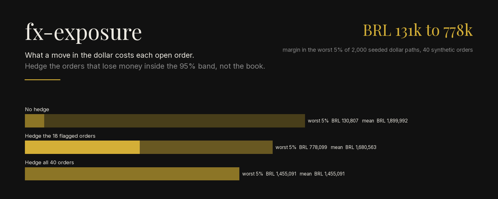
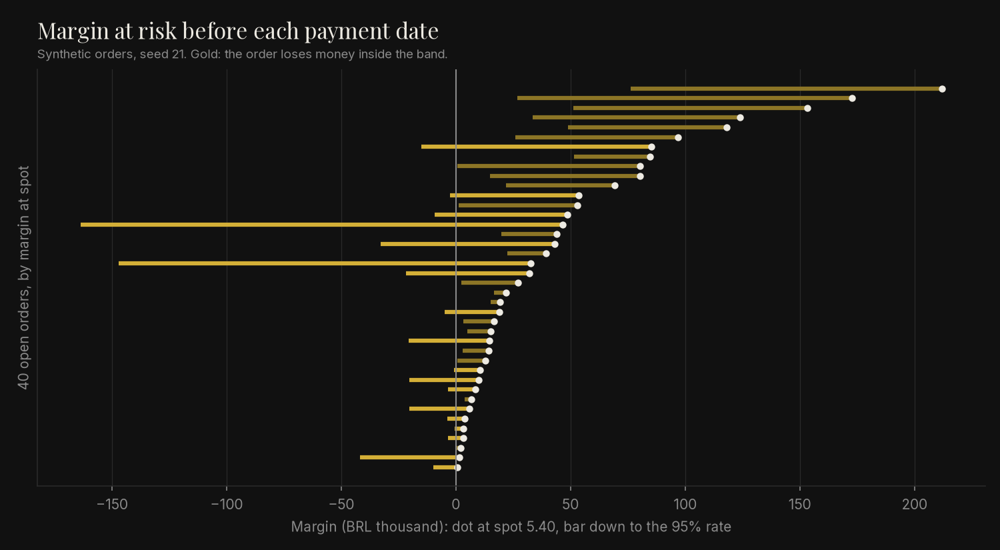
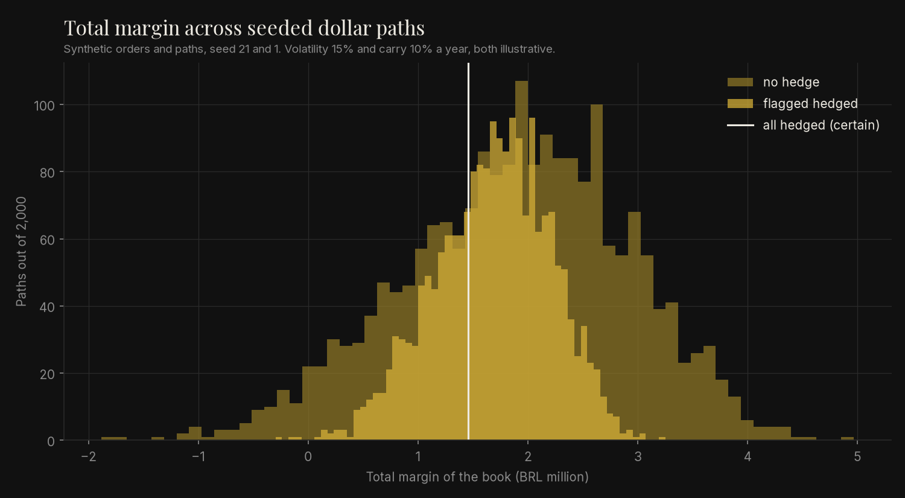

<p align="center">
  
</p>

<p align="center"><em>Synthetic data: 40 invented USD purchase orders, seed 21, and 2,000 seeded dollar paths. Spot 5.40, volatility 15% and carry 10% a year are illustrative, not market quotes.</em></p>

Reads a CSV of open import orders priced in dollars and shows, order by order, what a move
in the BRL/USD rate does to the margin before each one is paid. It flags the orders that
lose money inside a 95% band and writes a single HTML report a buyer can mail.

```bash
pip install -e ".[dev]"
python -m fx_exposure simulate          # worst 5% margin: 130,807 -> 778,099 BRL
pytest                                  # 100% coverage required
```

## Problem

An importer in Brazil prices a product in reais when the order is placed and pays the
supplier in dollars weeks later. The landed cost is set by the rate on the payment day,
with duty charged on top of the converted value. Finance sees the total dollar amount owed;
the buyer sees each order's margin at the rate used for costing. Nobody sees which orders
turn into losses if the dollar rises 10%, so either nothing is hedged or everything is,
and both cost money.

## Method

1. **Order model** (`model.py`): exposure in USD including duty, landed cost, margin at
   any rate, the margin moved by 1% and the break-even rate.
2. **Scenarios** (`scenarios.py`): margin under fixed shocks of -10% to +20%, and at the
   rate the dollar reaches with 5% probability before each payment date. An order is
   flagged when it loses money at that rate.
3. **Replay** (`simulate.py`): 2,000 seeded dollar paths, the book's margin with no hedge,
   with forwards on the flagged orders, and with forwards on all.
4. **Report** (`report.py`, `report.html.j2`): one static HTML file with the totals, a
   shock table and a bar per order.

Derivation and hand-checked cases: [docs/derivation.md](docs/derivation.md).

## How to run

```bash
pip install -e ".[dev,figures]"
ruff check . && mypy && pytest
python -m fx_exposure example orders.csv                 # the synthetic book
python -m fx_exposure scenarios examples/orders.csv --out result.csv --html report.html
python -m fx_exposure --spot 5.55 --vol 0.12 scenarios my_orders.csv
python -m fx_exposure simulate --paths 5000
PYTHONPATH=src python scripts/make_figures.py
```

The input CSV has one row per order: `po, sku, units, usd, duty_rate, other_brl,
sell_brl, costing_rate, due`. See [examples/orders.csv](examples/orders.csv).

## Result

Default run (asserted in the tests): 40 orders, margin at spot 1,884,588.73 BRL, margin at
risk inside the band 1,962,737.85 BRL, 18 orders flagged.

| Dollar move | -10% | 0% | +10% | +20% |
|---|---:|---:|---:|---:|
| Book margin (BRL) | 3,254,638.20 | 1,884,588.73 | 514,539.32 | -855,510.17 |

| Hedge | Orders hedged | Mean margin | Worst 5% | Worst path | Orders at a loss |
|---|---:|---:|---:|---:|---:|
| None | 0 | 1,899,991.54 | 130,807.27 | -1,882,285.69 | 4.0 |
| Flagged orders | 18 | 1,680,562.54 | **778,099.48** | -297,822.03 | 5.3 |
| All orders | 40 | 1,455,091.32 | 1,455,091.32 | 1,455,091.32 | 5.0 |

Hedging the 18 flagged orders gives up 219,429 BRL of mean margin and raises the worst 5%
almost sixfold. Hedging everything locks in 1,455,091 BRL but costs 444,900 BRL on average
against no hedge, and 5 orders still lose money at their forward rate: those were priced
too thin, which a hedge cannot fix. The count of orders at a loss rises with the flagged
policy because the forward is above spot for every hedged order.


*Synthetic orders, seed 21. Each bar runs from the margin at spot to the margin at the
95% rate. Long gold bars are large, late orders with thin margins.*


*Synthetic orders and paths. Hedging the flagged orders removes most of the left tail.*

## Limits

- Spot, volatility, carry and duty rates are illustrative inputs. The band is a model with
  constant volatility, not a forecast; real rate moves have fatter tails, so the worst 5%
  here is optimistic.
- The forward uses a flat carry. A real quote depends on the bank, the date and the
  spread, and the tool does not fetch any market data.
- Duty is a single rate on the USD value. Real import taxes stack several bases; `other`
  takes the parts fixed in reais, but a cascade that moves with the rate would need its
  own term.
- Sale prices are fixed. A company that can reprice passes part of the move on, so the
  real risk is lower than shown.
- The flag is a rule, not an optimisation: it ignores how much each hedge costs relative to
  the risk it removes.
- Technology choices: `Decimal` and the standard `csv` module because buyers already keep
  orders in spreadsheets and a cent of error in a margin is visible; Jinja2 for one static
  HTML file with inline SVG, so the result opens in any browser, offline, with no server
  and no script; argparse for a CLI with no other dependency. Jinja2 is the only run-time
  package.
- It serves accessible technology linked to logistics and industry: a CSV in, one HTML
  file out, readable by a buyer who never runs Python.
